# 实验二：搜索算法设计与性能分析

> 仓库链接：https://github.com/syyyyssyy/data-Project2
> 文中的运行时间是**固定输入在同一批次内重复测量的均值**。原始记录及绘图方法见文末“数据与复现”。

本实验完成四道搜索题，并在要求样例之外设计场景检验算法效率。题一用 A* 寻找普通迷宫最短路径，另试同分时优先深入，在单通路与开放地图上比较；题二用考虑进入费用和免费终点的 A* 求最低代价路径，另试行列代价下界，在条纹与棋盘地形上检验；题三用 Minimax 和 Alpha-Beta 求博弈树值，另试精确值置换表，并用共享状态和不同访问顺序的树观察剪枝；题四先算宝藏间距离，再用对抗搜索决定首步，另试状态记忆化与深度截止估值，并在四、六、八宝藏场景中分析搜索规模。各方法均与同场景的基础方法对照，分别记录答案、搜索量与运行时间。

## 1. 算法设计与实验设置

### 算法设计

四题共用两类核心过程：在网格中逐步寻找最低代价路线，以及在轮流决策中递归比较可能结果。前两题重点是 A* 如何利用不会高估的距离估计，后两题重点是 Minimax 如何回传得分、Alpha-Beta 如何减少无关搜索；题四还把两类过程串联起来。

在题一、二，状态是网格坐标 `n=(row,col)`；`g(n)` 是从起点到 `n` 已发现的最低代价，`h(n)` 是剩余代价下界，优先队列按 `f(n)=g(n)+h(n)` 取出候选节点。发现更小的 `g` 时更新父节点，终点到达后沿父节点逆向回溯路径。[astar.py](astar.py) 的 `search()` 共用这一套主循环，题一用单位步长，题二改用进入格子的权值。

在题三、四，MAX 选择使 A 的收益差最大的行动，MIN 选择使其最小的行动。Minimax 递归访问子状态并逐层回传极值。Alpha-Beta 额外维护 `α`（MAX 已能保证的下界）和 `β`（MIN 已能保证的上界）；当 `α≥β` 时，当前节点剩余子分支不会改变祖先的最终选择，因而可停止访问。剪枝改变的是搜索开销，不改变给定搜索深度下的最优值。本实验的剪枝数只统计**当前节点跳过的直接子分支数**，不等于所有未访问的后代数。

### 实验设置与评价方法

实验按研究内容分为三部分。**基础算法与正确性验证**：在四道题的要求样例及自设输入上核对最短路径、最小代价、博弈树根值和宝藏首步。**优化算法与对照实验**：在相同输入、起终点和搜索深度下比较原算法与改进方法，先确认答案一致，再比较搜索开销；深度截止的未来收益估值属于近似方法，另用完整搜索评价其首步质量。**自设场景与适用性分析**：改变迷宫结构、地形分布、博弈树访问顺序和宝藏数量，观察优化何时有效及何时增加开销。第 2～5 节逐题说明基础算法、要求样例及作业要求的效率对照；第 6 节集中介绍新增方法、自设场景和适用条件；第 7 节归纳证据与限制。

| 实验内容 | 主要输入与比较方法 | 每组重复测量 | 数据位置与计时范围 |
| --- | --- | ---: | --- |
| 基础算法与正确性验证 | 四题要求样例、自设正确性与边界案例；核对答案 | 自动化测试按测试用例运行；初步测量另见基础记录 | [tests](tests/)、[基础记录](results/raw_runs.csv)；正确性测试不当作性能样本 |
| 基础搜索策略对照 | 相同地图比较两种 A* 启发函数；相同博弈树或深度比较 Minimax 与 Alpha-Beta | 20 次，同一固定输入 | [对照数据](results/stage2/summary.csv)；计时取算法返回的搜索耗时 |
| 创新算法对照 | 大 `g` 同分优先、行列下界、精确值缓存、宝藏状态缓存及截止估值 | 50 次，同一固定输入 | [创新数据](results/innovations/summary.csv)及[估值数据](results/innovations/heuristic_evaluation_summary.csv)；计时覆盖完整函数调用，含预处理或建表 |
| 自设场景与适用性分析 | 单通路／开放地图、条纹／交错地形、同树不同顺序、4／6／8 宝藏及边界情况 | 性能案例 20 次；边界案例只做正确性测试 | [场景数据](results/extension/summary.csv)与[来源索引](results/extension/coverage.csv)；计时覆盖完整函数调用 |

题一、二的**搜索节点数**，指算法找到终点前实际取出并检查的地图位置数，包含终点；题三、四的**访问节点数**，指搜索实际计算的博弈局面数，包含中间局面和截止局面。两类节点代表不同工作，不能跨题直接比绝对数量。**叶节点数**是完成评价的截止局面数；**剪枝数**是 Alpha-Beta 判定后直接跳过的候选分支数，一个分支下可能还包含许多局面，因此不能把剪枝数当作节省的节点数。缓存方法另记录直接复用已有结果的次数；这类局面不计入“实际计算的局面数”。运行时间统一写为 ms，只在同一输入、同一种计时范围内比较。题三固定随机树种子为 2026；其余随机输入的种子见场景定义。重复 20 或 50 次测的是**同一固定输入的耗时波动**，不是生成同样数量的不同地图或树。

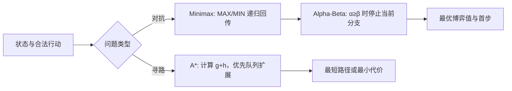

## 2. 题目一：迷宫寻路与启发式搜索

### 基础实现与样例验证

题一要求在有障碍的迷宫里，从起点走到终点，并输出最短路径。程序把**一个可通行格子的坐标**当作一个待搜索位置；从该格向上、下、左、右各走一步，便产生最多四个候选位置。遇到边界或障碍 `X` 就放弃该方向。由于每走一步的代价都是 1，到某格已走的步数就是 `g`；忽略障碍时离终点至少还需走的横向步数加纵向步数，就是曼哈顿估计 `h`。`astar.search()` 将候选位置放进优先队列，优先检查 `f=g+h` 较小的位置，相当于优先探索“目前已走步数加上预计剩余步数”较有希望的路线。

搜索中，程序为每个位置记下目前找到的最少步数和它是从哪个相邻位置走来的。若后来发现更短的到达路线，就更新这两项记录并把该位置重新放进队列；旧的较长路线以后取出时会被跳过。因此，队列中有候选位置时，程序不断检查当前最有希望的位置、寻找可走的邻格。按本题的单位步长和曼哈顿下界，终点被取出时，它记录的 `g` 就是最短步数。随后程序从终点沿“从哪里走来”的记录一步步退回起点，再把顺序反转，形成题目要求的起点到终点坐标列表。`maze_path()` 提供只返回这份列表的简洁接口；无路可走时返回 `[]`。

用实验要求的 5×5 迷宫验证：`S=(0,0)`，`E=(3,4)`，程序得到

```text
[(0,0), (0,1), (0,2), (1,2), (1,3), (1,4), (2,4), (3,4)]
```

它是程序记录的前驱关系回溯出来的路线：先沿第 0 行走到 `(0,2)`，在障碍前下转，再沿第 1 行和第 4 列抵达终点。8 个坐标对应 7 次合法移动，因此终点的 `g=7`；[路径复核函数](astar.py) `path_cost()` 独立检查相邻关系、障碍和总代价，结果与实验预期一致。迷宫存在多条同样短的路线时，程序只需返回其中一条。

### 启发函数对照

令 `h=0` 时，同一个 A* 主循环等价于按已付代价优先的 Dijkstra；曼哈顿启发 `h(n)=|r_n-r_E|+|c_n-c_E|` 不会高估四方向单位步长下的剩余步数。两组比较都得到相同最短步数：

| 场景 | 最短步数 | `h=0` 扩展 | 曼哈顿扩展 | 减少率 |
| --- | ---: | ---: | ---: | ---: |
| PDF 5×5 | 7 | 17 | 14 | 17.6% |
| 固定随机 20×20，seed=2026 | 38 | 335 | 235 | 29.9% |

数据来自 [基础搜索策略对照汇总](results/stage2/summary.csv)，图示见[图1](results/final_figures/图1_A星启发式效率对比.png)。减少率按 `(基线扩展数－启发式扩展数)/基线扩展数` 计算。两张图结构和规模不同，不能把减少率差异单独解释为“地图变大”的结果。

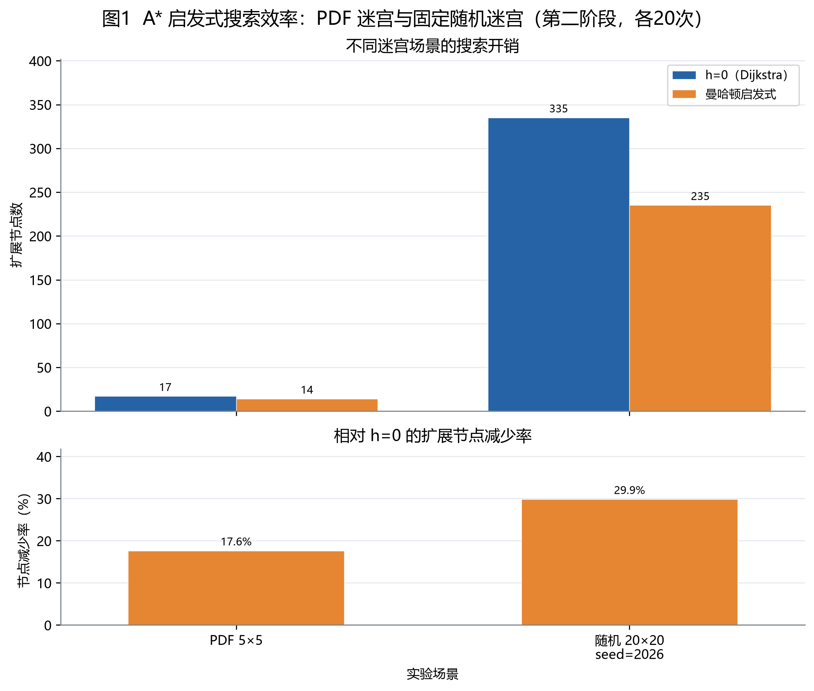

### 搜索效率评估

题一的效率看**找到终点前检查了多少个地图位置**，并辅以同场景平均耗时。曼哈顿启发保持最短步数不变：要求样例少检查 **3/17≈17.6%**，固定随机 20×20 地图少检查 **100/335≈29.9%**；后者平均搜索时间为 `h=0` **0.624 ms**、曼哈顿 **0.535 ms**，见[对照汇总](results/stage2/summary.csv)。这说明该地图中启发函数确实缩小了搜索范围；两张地图结构不同，不能据此推断地图越大，减少率必然越高。本题没有博弈分支，因此不评价 Alpha-Beta 剪枝效率。

## 3. 题目二：加权地形与可采纳启发函数

### 基础实现与路径代价

题二仍在四方向网格中找路，但目标改为**总代价最低**，所以最便宜的路线不一定是步数最少的路线。[`astar.search()`](astar.py) 沿用题一的优先队列、最小已付代价记录和路径回溯；区别在于探索相邻格时，将**要进入的格子**的权值加到 `g` 上，而不是每步固定加 1。起点没有“进入”这一步，故起点不收费；按题目规定，最后进入终点 E 也不收费。障碍仍不能进入。如果后来找到到同一格的更便宜路线，程序更新该格的 `g` 和前驱位置；取出终点后便沿前驱回溯最低代价路径。`weighted_cost()` 将搜索结果简化为题目要求的最小代价整数，无路可走时返回 `-1`。

优先队列仍按 `f=g+h` 选择位置，但这里 `h` 必须估计**剩余费用**，不能只估计剩余步数。程序使用全图最小正进入费 `c_min` 乘以“至少还要走、且需要收费的步数”：四方向到 E 至少走曼哈顿距离那么多步，其中仅最后一步可能免费，因此 `h=c_min×max(曼哈顿距离−1,0)`。实际路线若绕障碍会走更多步，其他收费格的权值也不会低于 `c_min`，所以这个估计不会高于实际剩余费用；这保证了 A* 所用启发值的可采纳性。直接使用普通曼哈顿距离不行：距离 E 一步时它给出 1，而真实剩余费用为 0。

实验要求的地图中，程序回溯出的最低代价路径为

```text
(0,0)→(1,0)→(2,0)→(3,0)→(3,1)→(3,2)→(4,2)→(4,3)→(4,4)
```

| 到达位置 | 起点 | (1,0) | (2,0) | (3,0) | (3,1) | (3,2) | (4,2) | (4,3) | E=(4,4) |
| --- | ---: | ---: | ---: | ---: | ---: | ---: | ---: | ---: | ---: |
| 本步进入费 | 0 | 1 | 1 | 1 | 1 | 1 | 1 | 1 | 0 |
| 累计代价 | 0 | 1 | 2 | 3 | 4 | 5 | 6 | 7 | **7** |

表中每一列对应程序从前一个格子走到该格子时加到 `g` 的费用；起点和 E 都加 0。路径走了 8 步，其中 7 次进入普通格子各付 1，因此到 E 时 `g=7`，与实验预期相符。[`path_cost()`](astar.py) 也按同一题目规则逐步独立复算。正式使用的启发式可写成

\[
h_{\mathrm{global}}(n)=c_{\min}\max(d_{\mathrm{Manhattan}}(n,E)-1,0),
\]

其中 `c_min` 是全图可通行格的最小正进入权值。用 `h=0` 和上述下界搜索实验要求的地图，最低代价同为 7；两者分别检查 **15** 和 **11** 个格子。基础搜索策略对照的 20×20 加权图两者都检查 **351** 个格子，30×30 内部目标图为 **318→194**；启发式并不保证每个输入都减少搜索量或运行时间，见[基础搜索策略对照汇总](results/stage2/summary.csv)。

### 搜索效率评估

本题同样用**检查位置数和运行时间**评价搜索效率，但必须先确认各方法得到相同的最低路径代价。要求样例中，免费终点下界比 `h=0` 少检查 **4/15≈26.7%** 的位置；30×30 内部目标图为 **318→194**，减少约 **39.0%**。效果并不稳定：固定随机 20×20 图两者都是 **351** 个位置，下界的平均搜索时间反而由 `h=0` 的 **0.870 ms** 增至 **0.988 ms**。计算启发值也有成本，故“少检查位置”与“总耗时更短”须分开判断。这里仍是寻路问题，不涉及博弈剪枝。

## 4. 题目三：Minimax、剪枝与访问顺序

### 基础实现与数值回传

题三要求从给定博弈树求根节点的最优值，并比较 Minimax 与 Alpha-Beta 的搜索开销。输入样例是外层带 `tree_structure` 的 JSON：内部节点用 `is_maximizing_player` 指明 MAX 或 MIN，并列出 `children`；叶节点只给整数 `value`。[`tree_from_dict()`](minimax.py) 先把这种输入转为树节点，检查根为 MAX、下层交替和叶值有效。命令行可用 `--tree-json` 读取文件；[`alpha_beta_score()`](minimax.py) 是只返回整数得分的简洁接口。

真正求值时，[`minimax()`](minimax.py) 从根开始递归：遇到叶子就把分数交回父节点；MAX 节点依次计算孩子并留下**最大**值，MIN 节点留下**最小**值。父节点拿到孩子的结果后再向上回传，一直回到根。它并非直接从所有叶子里挑最大数，而是考虑了对手在 MIN 层会选择对 MAX 最不利的分支。普通 Minimax 会访问整棵输入树的相关节点；[`alpha_beta()`](minimax.py) 使用相同的取最大、取最小规则，只在已能确定某些后续分支不会影响根的选择时提前停止。

以实验要求的树为例，最底层四个 MAX 子树分别把 `(3,5)`、`(6,9)`、`(6,9)`、`(1,2)` 回传为 **5、9、9、2**；其上的左右 MIN 分别取 `min(5,9)=5`、`min(9,2)=2`，根 MAX 最后取 `max(5,2)=5`。PDF 样例在代码中还可由 `pdf_tree()` 构造；其中一个 `(6,9)` 节点对象被两处引用，普通 Minimax/Alpha-Beta 到访两次仍分别计数。两种输入形式及根值 **5** 均由测试验证。

### 剪枝过程与算法对照

Alpha-Beta 在上述递归中额外传递两个界限：`α` 是 MAX 已有选择能保证的分数下界，`β` 是 MIN 已有选择能保证的上界。MAX 算出更好的孩子会提高 `α`，MIN 算出更差的孩子会降低 `β`；一旦 `α≥β`，当前节点剩余孩子不可能改善上层已经拥有的选择，可以跳过。被跳过的只是**当前已无需继续比较的分支**，最终回传的根值仍与 Minimax 相同。PDF 树按输入顺序从左到右搜索时，具体发生了以下剪枝：

```text
根 MAX
└─ 左 MIN
   ├─ 首个 MAX：访问 3、5 → 回传 5；左 MIN 的 β 更新为 5
   └─ 次个 MAX：带着 β=5 进入，先访问叶子 6
                  此时本节点 α=6 ≥ β=5 → 跳过剩余叶子 9
```

跳过 `9` 不会改变左 MIN 已有的上界 5，也不会改变根 MAX 最终得到的 5。此处剪枝数为 1，表示跳过一个直接子分支，不代表跳过了多少层后代。PDF 树 Minimax 访问 **15** 个节点、8 个叶子；默认 Alpha-Beta 访问 **14** 个节点、7 个叶子，根值相同。使用“每棵子树最左叶作排序线索”的 Alpha-Beta 在该小树访问 **13** 个节点，但效果依赖树的结构。

在固定种子 2026 的完整树（深度 6、分支因子 4、总 5461 节点）上，[图2](results/final_figures/图2_AlphaBeta剪枝效率对比.png)对应数据为：

| 方法 | 根值 | 实际计算的博弈局面数 | 评价的截止局面数 | 跳过的直接分支 | 平均时间 |
| --- | ---: | ---: | ---: | ---: | ---: |
| Minimax | -36 | 5461 | 4096 | 0 | 4.311 ms |
| 默认 Alpha-Beta | -36 | 1168 | 742 | 537 | 1.230 ms |
| 首叶排序 Alpha-Beta | -36 | 1272 | 724 | 921 | 2.402 ms |

默认 Alpha-Beta 相对 Minimax 少访问 **78.6%** 节点；首叶排序虽少评估 18 个叶子，却使总访问节点比默认 Alpha-Beta **增加 104 个**，且排序计算使平均时间更长。剪枝数从 537 增到 921 不能解读为总工作量下降，因为这些只是被跳过的直接子分支，大小可能相差很大。

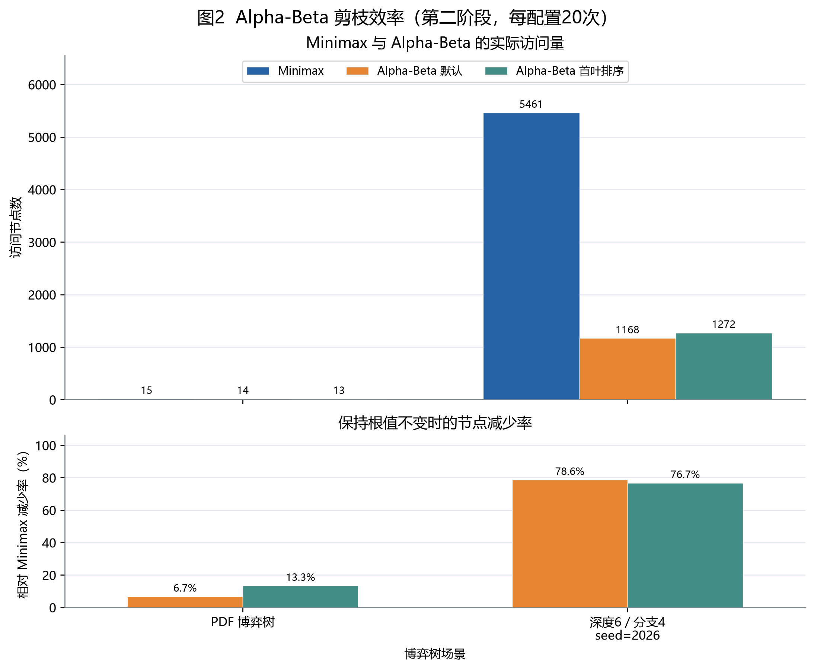

### 剪枝效率评估

本题直接比较**同一博弈树上实际计算的局面数、评价的叶子数和耗时**。要求样例中，Alpha-Beta 保持根值 **5**，访问数由 Minimax 的 **15** 降为 **14**，并跳过一个叶子；树太小，差异有限。固定种子的大树中，默认 Alpha-Beta 保持根值 **-36**，访问数 **5461→1168**，减少约 **78.6%**，平均搜索时间 **4.311→1.230 ms**。首叶排序虽然把叶点评价数 **742→724**，却把总访问数 **1168→1272**、平均时间 **1.230→2.402 ms**，说明排序线索和排序计算成本都需要实测。表中的“跳过的直接分支”只计当前节点没再访问的孩子，不等于省下的全部后代局面。

## 5. 题目四：距离预计算与宝藏分配

### 基础实现与距离矩阵

题四把前面的寻路和博弈搜索连起来：A、B 轮流选择尚未领取的宝藏，题目要给出 A 的最优首选宝藏及收益差。直接在每条博弈分支里重新走地图会反复计算相同的路，因此程序先调用 [`distance_matrix()`](treasure_game.py)，对 A、B、T1–T4 这六个关键点两两运行加权 A*，把最小移动代价存成 6×6 距离矩阵。后面的搜索只需查询“当前位置到目标宝藏的距离”。这一步用题四地图的进入费用规则：宝藏格进入代价为 1，与题二的“终点 E 免费”不同。矩阵的实际结果如下；[图10](results/final_figures/图10_宝藏间距离矩阵热力图.png)读取同一 [CSV](results/stage2/distance_matrix.csv) 绘制。

| 从\到 | A | B | T1 | T2 | T3 | T4 |
| --- | ---: | ---: | ---: | ---: | ---: | ---: |
| A | 0 | 12 | 10 | 4 | 8 | 8 |
| B | 12 | 0 | 8 | 8 | 4 | 10 |
| T1 | 10 | 8 | 0 | 6 | 6 | 12 |
| T2 | 4 | 8 | 6 | 0 | 6 | 6 |
| T3 | 8 | 4 | 6 | 6 | 0 | 6 |
| T4 | 8 | 10 | 12 | 6 | 6 | 0 |

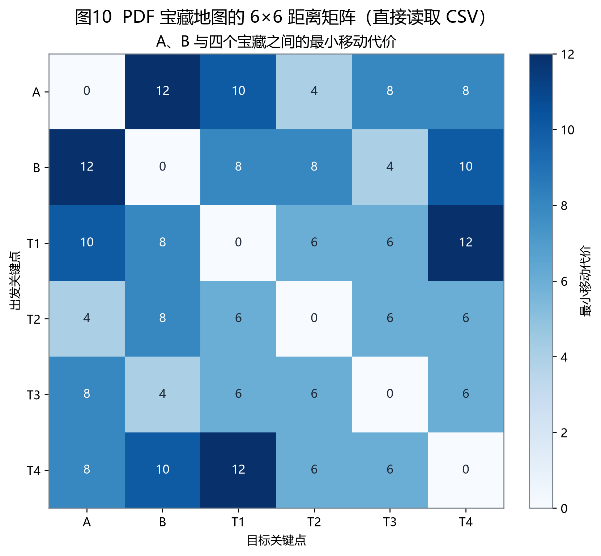

接着，程序用一个 [`GameState`](treasure_game.py) 记住 A、B 当前各在哪个关键点、还剩哪些宝藏、双方已经赚了多少以及轮到谁行动。一次“行动”是**明确选择一个未领取的宝藏**；[`take()`](treasure_game.py) 查距离矩阵，用 `宝藏价值－从当前所在点过去的最短移动代价` 算本次收益，把行动者移动到该宝藏，删去它，再换对方行动。路上经过其他宝藏不会顺便领取。每次 `take()` 都生成新状态，故递归探索一个候选首步后，不会改乱另一个候选首步的局面。

[`solve()`](treasure_game.py) 从 A 的当前状态出发，尝试每个可选宝藏，并递归考虑 B 如何回应、A 又如何行动。A 选择让最终 `Score_A−Score_B` 最大的分支，B 选择让这个差值最小的分支；这正是 Minimax 的 MAX/MIN 交替。深度 `H` 表示最多再选几次宝藏，每选一个便减 1；当 `H=0` 或宝藏取完，就用当时累计收益差评价局面，并逐层把分数传回根。根节点因此同时得到最优收益差和对应的**第一个宝藏**。标准求解可选 Minimax 或 Alpha-Beta；后者沿用题三的界限剪枝，答案不变，只可能少搜索一些分支。`best_treasure_choice()` 仅返回题目要求的首步和收益差，`solve()` 还保留搜索统计。

### 搜索深度与决策对照

例如 A 首步取 T2，收益 `6-4=2`；若 B 随后取 T3，收益 `7-4=3`，当前 `U=2-3=-1`。PDF 指定两种深度的实算结果为：

| H | Minimax/Alpha-Beta 首步 | 该深度内最优 `U` | Minimax 访问 | 默认 Alpha-Beta 访问 |
| ---: | --- | ---: | ---: | ---: |
| 2 | T2 | -1 | 17 | 13 |
| 4 | T3 | 3 | 65 | 47 |

H=2 只考虑 A、B 各一次选择，**-1 是两步截止时的评价**；H=4 搜完实验要求的四个宝藏，得到完整博弈的 T3／3。搜索深度改变了程序能看到的后续回应，因此首步由 T2 变为 T3。两种深度下 Minimax 与 Alpha-Beta 给出相同决策，后者分别少计算 **4** 和 **18** 个博弈局面；深度截止值不能直接当作完整博弈的最终收益。

### 剪枝效率评估

题四先用 A* 预计算距离，随后主要评估**宝藏博弈搜索的剪枝效率**。在相同深度和距离矩阵下，Minimax 与默认 Alpha-Beta 首步、收益差相同；H=2 时实际计算的局面数 **17→13**，减少约 **23.5%**；H=4 时 **65→47**，减少约 **27.7%**。[基础对照汇总](results/stage2/summary.csv)中的 H=4 平均搜索时间为 **0.132→0.101 ms**。这项时间只测博弈搜索，不包含距离矩阵的 A* 预计算，因此不能据此评价“预计算是否比每次重新寻路更快”。H=2 与 H=4 的收益差也属于不同搜索视野，不能当作同一决策质量直接比较。

## 6. 自设对照实验与创新优化

本节集中呈现基础算法之外的五种创新方法（题一、二、三各一种，题四两种），以及为检验适用条件构造的地图、博弈树和更多宝藏场景。五种方法集中于 [innovations.py](innovations.py)，不替换四题标准解题入口；题四的即时收益排序另作为访问顺序对照，不计入五种方法。评价精确优化时，先核对答案，再分别比较搜索量和完整调用时间；深度截止估值是近似方法，另评价固定首步后的完整收益。[创新算法汇总](results/innovations/summary.csv) 每组固定输入重复 50 次，外层计时包含函数调用、预处理和缓存构建，不能与前文算法内部计时直接混算。[图3](results/final_figures/图3_四项任务优化效果综合.png)只在相同场景与计时条件内配对计算 `(优化－基线)/基线×100%`，如实保留节点下降但时间上升的情况。

### 6.1 A* 同 `f` 值时优先较大 `g`

**思路与实现。** 当多个待扩展状态具有相同 `f`，改变优先队列的次级关键字，由入队先后改为 `-g`。主关键字仍是 `f`，发现更小 `g` 才更新父节点，所以最短路径答案不变。

```text
把起点压入优先队列，优先级设为 (f, -g, 入队序号)
循环取出 f 最小的有效状态 n：
    若 n 为终点：沿 parent 回溯并返回路径
    对每个四方向合法邻格 m：
        若发现更小的 g(m)：更新 g(m)、parent(m)
        计算 f(m)=g(m)+h(m)，按 (f(m), -g(m), 序号) 入队
```

**对照设计。** 先在实验要求的迷宫核对最短步数与默认 A* 相同，再用有多条等长路线的开放地图和只有一条通路的地图检验同分排序的适用条件。PDF 小图两种策略都检查 **14** 个位置；固定随机 20×20 地图中，大 `g` 优先把检查位置数从 **235** 降至 **47**，该组平均时间从 **0.537** 降至 **0.137 ms**。以下两张 25×25 地图进一步区分结构差异。

为单独检验**迷宫结构**，另外使用相同大小、起终点相同的两张 25×25 地图：一张只有蛇形通路，另一张没有障碍且有大量等长路线。在每张地图内部比较相同曼哈顿启发的 FIFO 与大 `g` 优先：

| 自设地图 | 最短步数 | FIFO 检查位置数 | 大 `g` 优先检查位置数 | 各地图组内平均时间 |
| --- | ---: | ---: | ---: | --- |
| 蛇形单通路 | 336 | 337 | 337 | 0.663 → 0.787 ms（自设场景数据） |
| 空旷多路径 | 48 | 625 | 49 | 1.429 → 0.150 ms（创新算法数据） |

这组比较的是**同一启发函数下的平局顺序**；两张图最短路径长度不同，不能只看跨地图的绝对节点数。空旷图复用已有实测记录，未重新计时；两行时间来源不同，只能分别在各自地图内部比较。图6展示两张地图及对应的检查位置数。

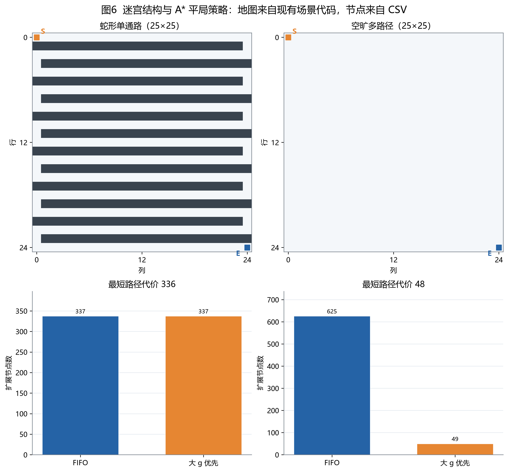

### 6.2 免费终点下的行列必经边界下界

**思路与实现。** 对每一行、列预计算可通行格的最低正常进入费，以前缀和快速求当前位置到 E 必须跨越的行边界与列边界费用，再扣掉一次进入 E 的正常权值，最后与 0 取最大。`weighted_axis_lower_bound()` 在调用 `search()` 时也使用大 `g` 同分优先。

```text
row_min[r] ← 第 r 行可通行格的最低进入费
col_min[c] ← 第 c 列可通行格的最低进入费
建立两组前缀和
对状态 n：
    cost ← n 到 E 必经行边界的最低费之和
          + n 到 E 必经列边界的最低费之和
    h(n) ← max(cost - E 的正常进入费, 0)
    按 f(n)=g(n)+h(n) 进行 A* 搜索
```

**可采纳性。** 每次四方向移动只跨越一条行或列边界；到达 E 必须至少跨越上述所有边界，绕路只会增加跨越次数。每条必经边界的真实进入费不低于对应最低费，故相加仍是普通收费规则的下界。本题恰好最后进入 E 免费，扣除**一次**其正常进入费即可形成免费终点下界；截到 0 避免负估计。障碍不会破坏这一论证，因为它不会减少必须跨越的边界。

**对照与限制。** PDF 加权图中原方法检查 **11** 个位置，仅改平局与行列下界均为 **9**：少掉的两个位置不能归功于新下界本身，且行列下界平均 **0.069 ms**，慢于原方法 **0.051 ms**。为检验地形权值分布，再比较 25×25 的高价条纹图和 1/9 棋盘交错图。两图均保持终点 E 免费；表中后三列是检查的地图位置数：

| 自设地形 | 最优代价 | 全图下界 | 全图下界＋同分深入 | 行列下界＋同分深入 |
| --- | ---: | ---: | ---: | ---: |
| 每第 5 列高价 7，其余 1 | 71 | 601 | 481 | **49** |
| 权值 1/9 棋盘交错 | 239 | 625 | 625 | **625** |

条纹图里，横向移动不可避免地穿过若干高价列，行列下界因此比全图最低费更有信息量；该图全图下界平均 **2.192 ms**，行列下界 **0.657 ms**。棋盘图每行每列都有权值 1 的格子，按行列取最低费无法识别实际必经的高价格；该图 `h=0` 及表内三种 A* 都检查 **625** 个位置，平均时间分别为 **1.819、2.136、2.139、2.551 ms**。预处理在此图上增加了耗时。条纹图未测 `h=0`，图7如实留空；两行时间来自不同测量批次，不能直接跨行排名。图7显示实际地形和这组结果。

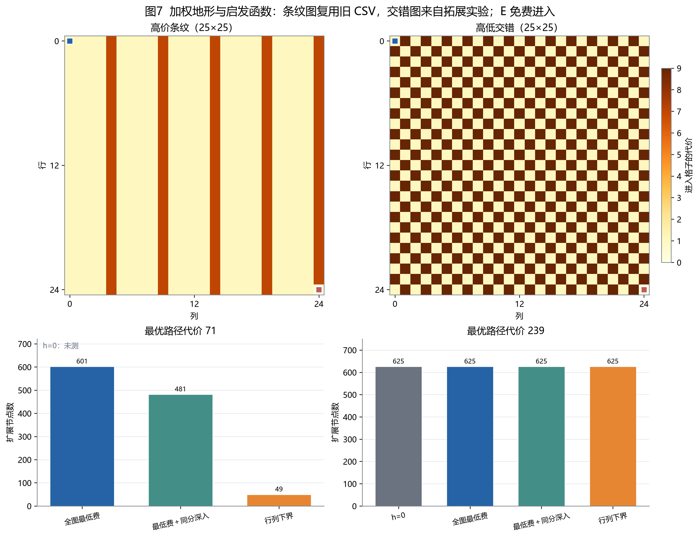

为解释图7中的差异，[图11](results/final_figures/图11_加权启发函数紧度检验.png)对两张现有 25×25 地图的每个可达格子，计算到免费终点 E 的**真实最低剩余代价**，再与两种启发值逐格比较。虚线代表“估计恰好等于真实代价”；所有点均位于虚线及其下方，说明在这两张地图上未发现高估。条纹图的“启发值／真实代价”中位数由全图下界的 **0.68** 提高到行列下界的 **1.00**，解释了搜索位置数 **601→49**；棋盘图两种下界逐格相同，中位数都为 **0.20**，因此没有提供额外方向信息。这里的“真实代价”用反向 Dijkstra 按**进入 E 免费**的规则重新计算，仅用于事后分析，不参与 A* 当时的排序；逐格数据见[启发值核对 CSV](results/final_figures/analysis_data/task2_heuristic_tightness.csv)。图中的紧度不是算法运行时间，预处理开销仍需结合前述计时判断。

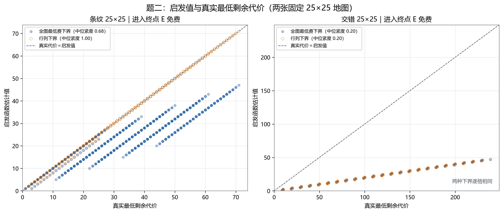

### 6.3 Alpha-Beta 精确值置换表

**思路与实现。** PDF 的 Python 树和自设 DAG 可以让多个父节点引用**同一个节点对象**。`alpha_beta_transposition()` 以 `(节点对象身份, MAX/MIN 身份)` 为键，复用已完整求得的子树值。剪枝只说明某值已经足以界定祖先选择，未搜索完的子树值可能只是界限，不能当作精确值写入表。

```text
访问(node, player, α, β)：
    若 (node身份, player) 有精确缓存：返回缓存值
    若为叶子：记录叶值为精确缓存并返回
    按 Alpha-Beta 规则递归孩子，更新 α 或 β
    若 α≥β：停止余下孩子，并将本节点标记为“非精确”
    只有所有相关子树均完整求值时，才缓存本节点精确值
    返回本次求得的值及“是否精确”标记
```

| 场景 | 普通 Alpha-Beta 访问 | 带置换表实际求值访问 | 缓存命中 | 平均时间 |
| --- | ---: | ---: | ---: | --- |
| PDF 树，根值 5 | 14 | 13 | 1 | 0.019 → 0.013 ms |
| 固定 seed=2026 的共享 DAG，根值 -10 | 770 | 129 | 159 | 0.786 → 0.222 ms |

共享 DAG 中实际计算的博弈局面减少约 **83.2%**；PDF 小树仅命中一次，微小时间差受测量噪声影响，不能据此声称置换表在所有小树都更快。此方法按**对象身份**缓存，两个结构相似但独立创建的节点不会自动合并。表中的计算局面数不含直接复用缓存值的局面；[逐次记录](results/innovations/raw.csv)另保存总调用次数，可区分“调用函数”和“重新计算局面”。

### 6.4 自设博弈树：访问顺序对剪枝的影响

为单独观察访问顺序，使用同一棵深度 6、每层 4 个孩子、固定种子 2026 的完整树，仅重新排列子树。三种排列的叶值、树形和根值 **-36** 相同，Minimax 均访问 **5461** 个节点。原顺序按生成顺序访问；“有利顺序”把真实值较高的子树放在 MAX 前面、真实值较低的放在 MIN 前面；“不利顺序”反过来。对应 Alpha-Beta 的访问数和平均耗时为：

| 同一棵树的顺序 | 实际计算的博弈局面 | 平均搜索时间 |
| --- | ---: | ---: |
| 原顺序 | 1168 | 1.310 ms |
| 事后有利顺序 | 268 | 0.336 ms |
| 事后不利顺序 | 4806 | 4.316 ms |

该组说明界限能否**尽早收紧**，强烈影响剪枝效率。不过有利和不利顺序依据子树**真实 Minimax 值事后构造**，排序构造时间没有计入搜索时间；它们是敏感性分析，不是实际搜索时免费可用的排序算法。前文“首叶排序”才是可在搜索时计算的排序线索，在这棵树上访问数却由 **1168** 增至 **1272**。[图5](results/final_figures/图5_AlphaBeta节点排序适用性.png)同时保留有利与不利结果。

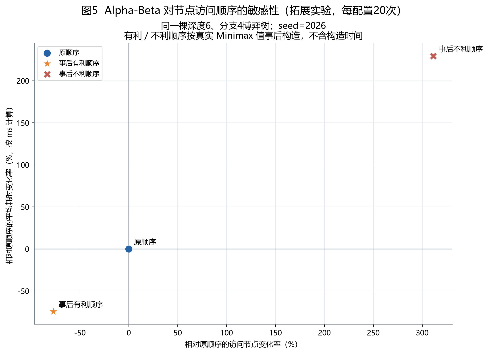

[图12](results/final_figures/图12_博弈树逐层剪枝效果.png)将同一棵树的访问数拆到第 0～6 层，并用[逐层追踪 CSV](results/final_figures/analysis_data/task3_depth_trace.csv)核对每种策略的访问数总和。Minimax 访问全部 **4096** 个叶子；默认 Alpha-Beta 只访问 **742** 个，事后有利顺序为 **127** 个，事后不利顺序仍访问 **3530** 个。首叶排序虽然比默认顺序少访问 **18** 个叶子，却在第 2～5 层访问更多中间局面，故总访问数反而由 **1168** 增到 **1272**。这比只看“剪枝次数”更能说明不同层的搜索开销；事后顺序依旧不能作为实用排序器。逐层追踪所得根值、总访问数、叶子数和直接跳过分支数均与既有实验 CSV 一致；图中不比较重新追踪过程的运行时间。

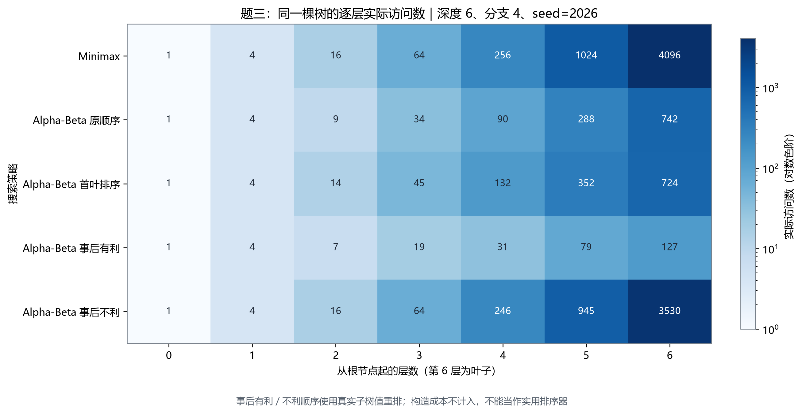

### 6.5 宝藏状态记忆化与即时收益排序

**记忆化思路。** `treasure_memoized()` 缓存键为 `(A位置, B位置, 剩余宝藏, 行动方, 剩余步数)`，缓存值是**从当前局面往后的增量收益差**。当前已累积的 `Score_A-Score_B` 在返回根节点时再加，因此历史分数不同而未来局面相同的状态仍可复用。

```text
Future(state, turns)：
    若状态与剩余深度命中缓存：返回后续增量收益差
    若 turns=0 或宝藏已空：返回 0
    对当前行动方所有未领取宝藏：
        计算本步收益，递归新的位置、剩余集合、下一行动方
        A 取最大后续收益差；B 取最小后续收益差
    将精确后续增量收益差写入缓存并返回
根的总效用 = 已累计收益差 + Future(state, H)
```

该实现是**无 Alpha-Beta 剪枝的 Minimax 记忆化**，并非“记忆化 Alpha-Beta”；只有这样才可直接和 `cache=False` 的同一递归式比较缓存作用。PDF H=4 中未缓存/缓存访问 **65→53**、命中 **12** 次，但平均时间 **0.065→0.075 ms**，缓存管理在这个小问题中没有带来时间优势。六宝藏 H=6 时访问 **1957→487**、命中 **510** 次，平均时间 **1.989→1.193 ms**，重复状态增多后收益明显。二者最优首步和效用均保持一致。

**排序与规模场景。** 标准 `solve(..., order="gain")` 在每个节点先访问对当前行动者即时收益 `V_i-d(p,T_i)` 较高的宝藏，让 `α/β` 可能更早收紧；最终值仍由递归计算。它属于 Alpha-Beta 访问顺序实验，**与上一段的 Minimax 缓存是不同实验组**。为观察搜索规模，除原题四宝藏外，还在确定性的无障碍 8×8 抽象距离矩阵中设置六、八个宝藏，分别测固定 H=4 和取完全部宝藏时的深度。同一行内三种策略得到相同收益差，访问数与同组平均时间来自[自设场景汇总](results/extension/summary.csv)：

| 宝藏数与深度 | Minimax 访问 | 默认 Alpha-Beta 访问 | 收益排序 Alpha-Beta 访问 | 默认 → 排序平均时间 |
| --- | ---: | ---: | ---: | ---: |
| 4 个，实验要求地图 H=4 | 65 | 47 | 37 | 0.112 → 0.108 ms |
| 6 个，H=4 | 517 | 130 | 83 | 0.299 → 0.229 ms |
| 6 个，H=6（完整） | 1957 | 362 | 243 | 0.858 → 0.679 ms |
| 8 个，H=4 | 2081 | 531 | 232 | 1.660 → 0.874 ms |
| 8 个，H=8（完整） | 109601 | 16864 | 2592 | 85.335 → 16.558 ms |

八宝藏完整深度下，收益排序使 Alpha-Beta 访问数从 **16864** 降至 **2592**，约少 **84.6%**，但排序本身也需要计算，不能保证所有布局都受益。固定 H=4 与完整深度的意义不同，图8分开显示。四宝藏采用原题 7×7 地图，六、八宝藏采用无障碍 8×8 抽象距离矩阵；地图也随宝藏数改变，这些行不能视为严格只改变宝藏数量的规模定律。缓存命中与剪枝分支也属于不同统计口径。

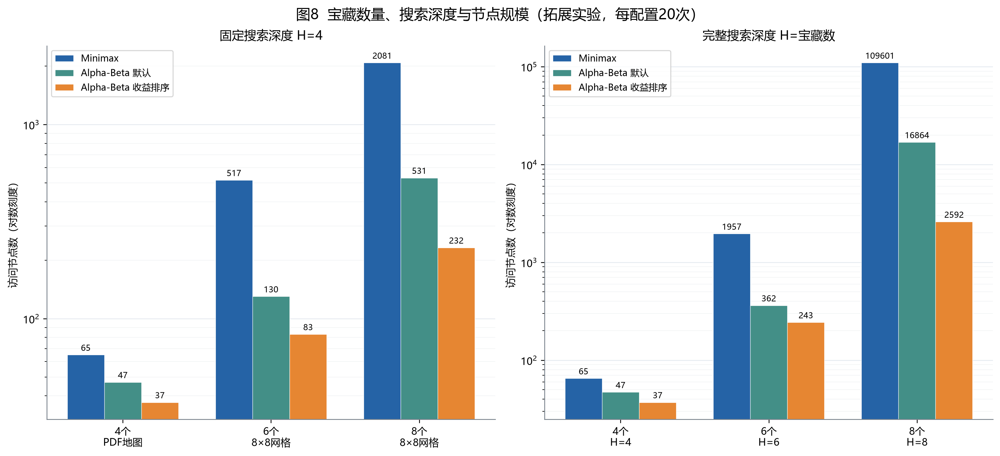

### 6.6 深度截止时的未来收益估值：近似拓展

标准题四到达 H=0 时直接用当前 `U`；可选的 `treasure_estimated()` 在**仍有宝藏**时用 `Eval=U+FutureEstimate`。`FutureEstimate` 按当前行动顺序，假设每位玩家反复选自己即时收益最高的剩余宝藏，模拟后续收益差。它是有具体规则的预测，不是完整 Minimax 值，也不保证可采纳或决策更优；宝藏已取完时仍返回精确当前 U。

为检验短视野首步的实际质量，实验先固定算法选出的第一个宝藏，再用完整深度搜索后续对抗。原题四宝藏 H=2 选择 T2，截止评价是 **-1**，而固定 T2 后完整收益差是 **1**；直接完整搜索选择 T3，可得 **3**。[图4](results/final_figures/图4_宝藏搜索深度与决策变化.png)将 H=1–4 的首步和这种固定首步后的完整收益分别绘制，图中数据来自[估值实验汇总](results/innovations/heuristic_evaluation_summary.csv)。

H=3 时，原评价首步 T2，固定该首步后的完整收益差 **1**，相对完整最优 **3** 损失 2；估值评价改选 T3，完整收益差 **3**、损失 0。但六宝藏 H=1 出现反例：原评价选 T1，完整收益差 **6**；估值改选 T2，完整收益差 **5**，反而损失 1。因此报告近似算法时须分别列**截止估计值、所选首步和固定首步后的完整收益**，不能把估计值写成实际最终收益。

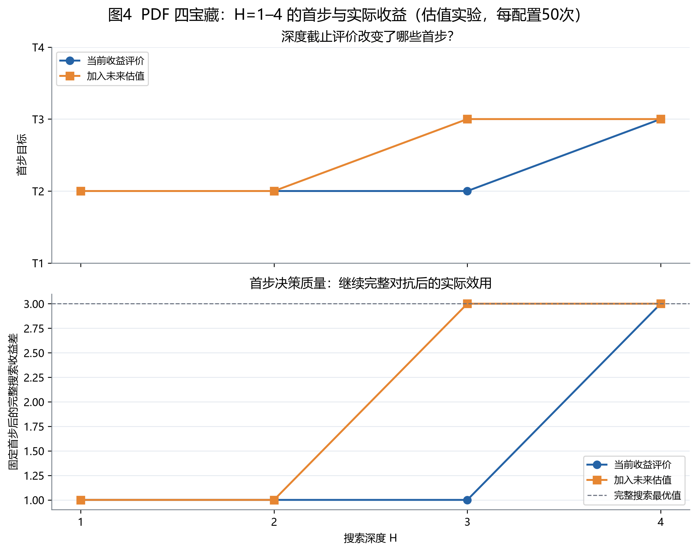

[图13](results/final_figures/图13_宝藏深度决策与收益损失.png)把同一份[估值实验汇总 CSV](results/innovations/heuristic_evaluation_summary.csv)中的四宝藏、六宝藏案例并排：每格标出该深度选的首步，以及固定首步后相对完整最优收益的损失。四宝藏 H=3 的未来估值使首步由 T2 改为 T3，损失由 **2** 降为 **0**；六宝藏 H=1 却使首步由 T1 改为 T2，损失由 **0** 增为 **1**。四宝藏 H=4、六宝藏 H=6 已搜完所有宝藏，估值函数没有调用，两个方法结果相同。色块显示的是**事后完整收益损失**，不是深度截止时的预测值，也不能据这两个固定场景断言估值普遍有利。

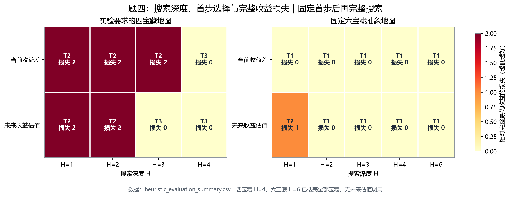

### 6.7 四题优化效果合看

图3只使用创新实验同批次的可比对照，不把不同批次时间拼在一起。典型点包括：题一空旷图大 `g` 优先节点变化约 **-92.2%**、时间约 **-89.5%**；题三共享 DAG 置换表约 **-83.2%**、**-71.7%**；题二 PDF 地图行列下界节点约 **-18.2%**、时间却约 **+36.8%**；题四 PDF H=4 记忆化节点约 **-18.5%**、时间约 **+15.7%**。后两者说明“减少访问节点”与“缩短总调用时间”是两项不同结论。按 `(优化－基线)/基线` 的变化率定义，两个指标同时下降位于图3**左下**象限。

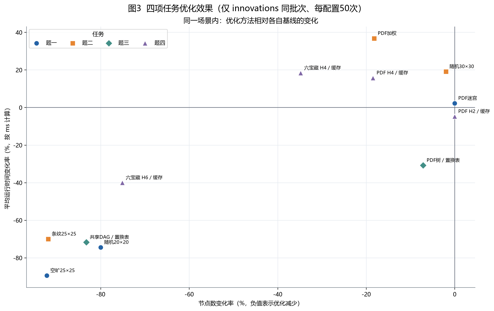

## 7. 总结、限制与独立思考

### 基础算法与正确性验证

四题要求样例均得到规定的路径、代价、博弈树值及宝藏首步；项目还提供与要求格式对应的简洁输出接口。`python -m unittest discover -s tests -v` 已通过 **36 项测试**。[边界测试](tests/test_extension.py) 还覆盖普通迷宫无路返回空列表、加权地形无解返回 `-1`、多个等长最短路径、宝藏即时收益全负、并列首步及宝藏提前取完；选择不可达宝藏时抛出 `ValueError`。这些案例检验了已覆盖的输入，没有作为性能样本写入 CSV，也不能代替对全部可能输入的证明。

### 优化算法与对照实验

四题先用基础方法确认答案，再改变启发函数、剪枝、访问顺序或缓存方式。下表按题目概括**比较了什么**与**实际观察到什么**；完整设置、原始记录和限制见第 2～6 节。

| 题目 | 基础对照与新增方法 | 主要实测结果 |
| --- | --- | --- |
| 一：普通迷宫 | `h=0` 对比曼哈顿 A*；在相同曼哈顿启发下，FIFO 对比同 `f` 时大 `g` 优先 | 固定随机 20×20 图中，曼哈顿使检查位置数 **335→235**；开放 25×25 图中，大 `g` 优先使其 **625→49**，单通路则 **337→337**。 |
| 二：加权地形 | `h=0` 对比免费终点下界；再比较全图最低费、只改同分顺序、行列下界 | 要求样例的 `h=0` 与免费终点下界均得代价 **7**，检查位置数 **15→11**；条纹图中全图下界、只改同分顺序、行列下界依次为 **601→481→49**，交错图三者均为 **625**。 |
| 三：博弈树 | Minimax 对比默认、首叶排序 Alpha-Beta；另试精确值置换表与事后调整的子树顺序 | 完整树的 Minimax／默认 Alpha-Beta 计算 **5461／1168** 个局面；共享 DAG 中置换表使实际求值 **770→129**；同树事后有利／不利顺序为 **268／4806**。 |
| 四：宝藏分配 | H=2、H=4 下比较 Minimax 与 Alpha-Beta；另试状态记忆化、即时收益排序和深度截止估值 | 要求样例 H=2 选 **T2／-1**、H=4 选 **T3／3**；六宝藏完整深度下，记忆化 Minimax 的计算局面 **1957→487**；八宝藏完整深度下，收益排序 Alpha-Beta **16864→2592**。截止估值有改善和变差的实例。 |

这些数字仅在各自输入与统计口径内比较：题一、二统计检查的地图位置，题三、四统计实际计算的博弈局面；时间还需限定相同计时范围。下面进一步解释数据背后的原因与局限。

| 需要解释的问题 | 可直接核对的证据 | 为什么出现这种现象 |
| --- | --- | --- |
| 启发式为何有时少扩展，有时无收益？ | 图1中 20×20 迷宫 `335→235`；图7中交错地形四种方法都为 `625` | 曼哈顿距离提供到目标的步数下界；交错地形各行列都有低价格，最低费下界难以分辨实际高价路径。 |
| 为什么访问顺序影响剪枝？ | 图2的完整树默认 Alpha-Beta 访问 `1168`；图5中同树事后有利／不利顺序为 `268／4806` | 先访问有利子树会更早收紧 `α` 或 `β`，使后续分支更早满足剪枝条件。 |
| 为什么节点减少不等于速度提高？ | 图3中 PDF 加权图行列下界 `11→9` 个扩展节点，平均时间 `0.051→0.069 ms` | 计算更复杂下界和预处理本身也消耗时间；小图节省的扩展不足以抵消额外工作。 |
| 深度为何改变宝藏首步？ | H=2 为 `T2/-1`，H=4 为 `T3/3`；图4把固定首步后的完整收益另列 | H=2 只评价两次行动后的局面，H=4 包含四次行动，后续反应会改变首步的相对价值。 |

这些图表分别回答“得到什么结果”和“为什么得到该结果”。图中的固定输入与重复计时不能证明普遍优势；图5的有利顺序按真实子树值事后构造，也不能当作实际搜索时免费可用的策略。

实验显示：可采纳启发函数和同分策略在部分迷宫少检查位置；Alpha-Beta 在保持 Minimax 根值的同时少计算博弈局面；即时收益排序和状态记忆化在当前较大宝藏场景中降低开销。图表也保留了反例：棋盘交错地形的下界预处理、小规模宝藏的缓存和完整树上的首叶排序，均可能无收益或增加时间。

### 自设场景、适用条件与后续思考

自设场景不只用于展示更多数字，还用来找出**什么时候有效、开销卡在哪里、哪些情况没有收益**：

| 自设场景 | 适用条件与实测证据 | 瓶颈或特殊情况 |
| --- | --- | --- |
| 蛇形单通路／空旷迷宫 | 大 `g` 平局优先在开放图把检查位置数 **625→49**；适合大量候选位置具有相同 `f` 的情形。 | 单通路两策略均检查 **337** 个位置，排序多做了工作却无搜索收益；两图路径长度不同，只能各自在同一地图内比较。 |
| 条纹／1:9 棋盘地形 | 条纹图中，全图下界、只改同分顺序、行列下界加同分深入依次检查 **601、481、49** 个位置；行列下界适合必经行或列的最低费用能反映高价条带的情形。 | 棋盘图各行列都有低价格，四种策略均检查 **625** 个位置；行列下界的预处理使该组平均时间达到 **2.551 ms**，高于 `h=0` 的 **1.819 ms**。 |
| 同树不同顺序／共享 DAG | Alpha-Beta 在同一棵树上的访问数随顺序由 **268** 到 **4806**；精确值置换表在共享 DAG 上使实际求值 **770→129**。 | 事后有利顺序需要预先知道真实子树值，不能直接作为实用排序器；置换表依赖重复状态并需要查表，内存占用尚未实测。 |
| 四／六／八宝藏与深度变化 | 八宝藏完整深度下，收益排序使 Alpha-Beta 访问数 **16864→2592**；六宝藏完整深度下，记忆化 Minimax **1957→487**。 | 搜完更多宝藏使搜索树快速增长；四宝藏 PDF 案例的缓存使时间 **0.065→0.075 ms**，小规模未获时间收益。四宝藏与六／八宝藏采用不同地图，不能把差异全归因于宝藏数。 |
| 边界正确性案例 | 无可达路径、等长最短路、负收益宝藏、并列首步、宝藏提前耗尽均由测试覆盖。 | 这些案例只验证算法在特殊输入下的行为，**未做重复计时**，不能当作性能对照结论。 |

上述结果来自有限的固定场景，不能推出所有输入的速度排名。现有随机迷宫、完整博弈树和共享 DAG 主要采用固定种子；重复 20 或 50 次测的是**同一输入的耗时波动**，不是 20／50 个独立随机实例。基础搜索策略对照在算法内部计时，创新方法与自设场景的测量覆盖完整函数调用；正文只在同一场景和计时范围内比较时间。不同机器、不同输入分布和缓存占用尚未系统研究。后续可增加多个随机种子与障碍率，使用廉价的排序线索，并同时报告搜索节点、运行时间和缓存容量。

### 数据与复现

| 内容 | 文件与作用 |
| --- | --- |
| 基础搜索策略对照原始/汇总 | [raw.csv](results/stage2/raw.csv)、[summary.csv](results/stage2/summary.csv)：PDF 与固定随机样例，20 次/组；图1、图2。 |
| 创新原始/汇总 | [raw.csv](results/innovations/raw.csv)、[summary.csv](results/innovations/summary.csv)：四题优化对照，50 次/组；图3与部分图6、图7。 |
| 深度截止估值 | [原始记录](results/innovations/heuristic_evaluation_raw.csv)、[汇总](results/innovations/heuristic_evaluation_summary.csv)：预测与实际收益分列；图4。 |
| 拓展原始/汇总 | [raw.csv](results/extension/raw.csv)、[summary.csv](results/extension/summary.csv)：自设场景，20 次/组；图5、图8与部分图6、图7。 |
| 场景与来源索引 | [cases.csv](results/extension/cases.csv) 定义场景，[coverage.csv](results/extension/coverage.csv) 区分本轮新测、旧数据复用及仅正确性测试。 |
| 距离矩阵 | [distance_matrix.csv](results/stage2/distance_matrix.csv)：6×6 实算数据；图10。 |
| 补充分析记录 | [题二逐格启发值](results/final_figures/analysis_data/task2_heuristic_tightness.csv)与[题三逐层访问数](results/final_figures/analysis_data/task3_depth_trace.csv)：由固定场景重新计算，用于图11、图12；不含新的计时样本。图13直接使用上方的估值汇总。 |
| 绘图 | [plot_results.py](plot_results.py) 只读现有数据，输出图1～图8、图10和[逐图说明](results/final_figures/图表说明.md)；[plot_analysis.py](plot_analysis.py) 输出图11～图13及[补充说明](results/final_figures/图11-13_说明.md)。图9需要完整决策树轨迹，现有 CSV 只有汇总，因此未生成。 |

复现命令（在 `experiment2` 目录）：

```powershell
python -m unittest discover -s tests -v
python stage2.py --repeats 20 --seed 2026
python innovation_experiments.py --repeats 50
python extension_experiments.py --repeats 20
python plot_results.py
python plot_analysis.py
```

重跑前三个实验脚本会覆盖对应批次 CSV，运行时间可随机器负载变化；如只需重建图表，单独运行最后两条绘图命令即可。`plot_analysis.py` 只会更新图11～图13及其新分析记录，不改动原有实验数据。